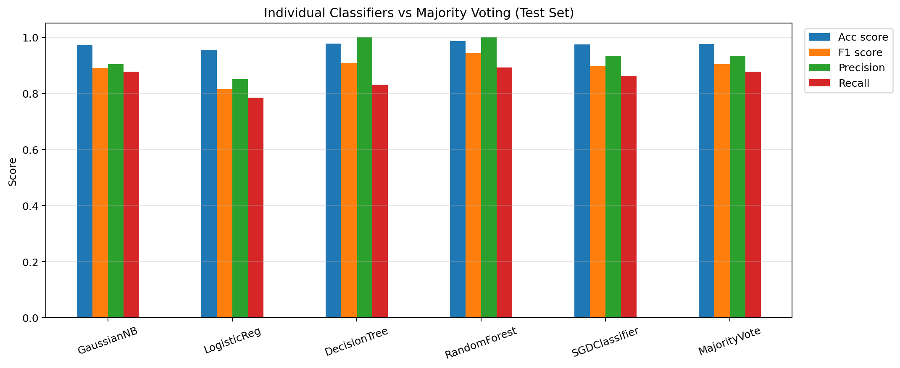
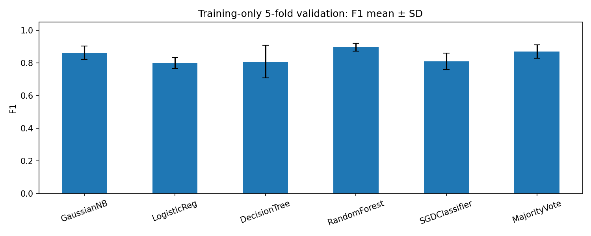
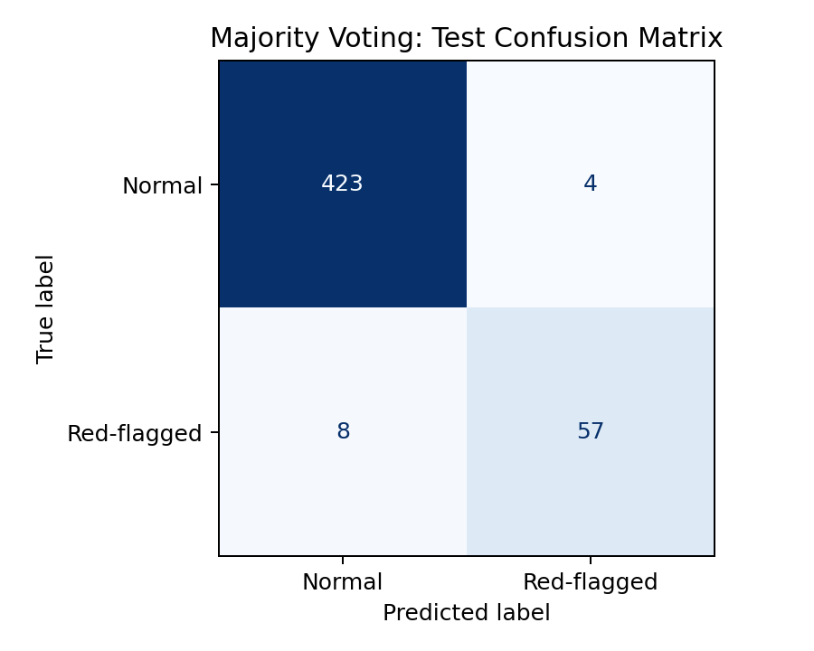

# Transaction Fraud Detection with Majority Voting

A reproducible, educational machine learning project comparing five classical
classifiers with a three-out-of-five majority-voting ensemble on transaction data.
Developed as an extension of HKU COMP7409A Tutorial 1.



## What this project demonstrates

- Missing-value inspection, training-set EDA and log-transformed transaction amounts.
- Categorical encoding, correlation analysis and standardized model inputs.
- Gaussian Naive Bayes, logistic regression, decision tree, random forest and an SGD-trained linear SVM.
- Equal-weight hard voting: predict a red flag when at least three of the five models predict 1.
- An 80/20 stratified train/test split and five-fold stratified cross-validation on training data.
- Fold-local imputation and scaling through scikit-learn pipelines.
- Accuracy, F1, precision, recall, confusion matrix and model timing comparisons.

## Repository contents

```text
fraud_detection.ipynb       Complete notebook with executed outputs
fraud_detection.py          Equivalent runnable Python script (same cell order)
requirements.txt            Supported dependency ranges
requirements-tested.txt     Exact main package versions used for the recorded run
README.md                   Project overview and results
GITHUB_UPLOAD_GUIDE_ZH.md    Chinese upload instructions and suggested metadata
data/README.md              Data placement and schema instructions
results/                    Plots, aggregate metrics, and recorded runtime versions
```

## Data and prediction task

The course file `tranrecords.csv` contains 2,500 rows. Following the original lab's
missing-ID rule removes 44 rows, leaving 2,456: 2,134 normal records and 322 red flags.
The fixed split uses 1,964 training rows and 492 test rows (65 positives in the test set).

- Target: `RedFlag` (0 = normal, 1 = flagged).
- Model features: `Amount`, `Fiscal Year`, and `Status`.
- Additional EDA fields: `Department` and `Month`.
- `TranNo` is an identifier, not a predictor.
- A red flag is a dataset label, not independently established fraud.

The raw CSV and lecture slides are **not bundled**. Obtain the original course data
through authorized course access and place it in `data/tranrecords.csv`. See
[data instructions](data/README.md). The notebook retains small example tables and
aggregate plots from the recorded run.

## Run in Google Colab

1. Open `fraud_detection.ipynb` in Colab (upload the notebook or open it from your repository).
2. Run the notebook from top to bottom. The first cell installs dependencies in Colab.
3. When prompted, upload `tranrecords.csv`.
4. View the comparison table, majority-vote examples, and charts. Generated files are in `results/`.

The CSV is stored in the Colab runtime, so a fresh runtime may require another upload.
Colab packages can differ from the recorded local environment; consult the printed versions.

## Run locally

Python 3.12 was used for the recorded run. From the repository directory:

```bash
python -m pip install -r requirements.txt
python fraud_detection.py
```

To match the main package versions of the recorded run, install
`requirements-tested.txt` instead. For Jupyter, install `jupyterlab` separately and
open the notebook; the exported script does not require Jupyter.
An optional environment variable `LAB1_DATA_PATH` can point to a CSV outside `data/`.

## Evaluation design

The test partition is held out before EDA and fitting. All EDA uses the training
partition. Cross-validation refits preprocessing inside each fold, then fixed models
are fitted on the complete training partition for the final test comparison.
No hyperparameters or features are selected from test results.

The five base model predictions are reused for the final vote. Five-fold validation
uses `VotingClassifier(voting="hard")` inside a pipeline. The manual final vote was
checked against the corresponding fitted scikit-learn voting classifier and agreed
on every test prediction. RandomForest is one voter, not 100 voters, at the outer level.

The SGD classifier explicitly uses `loss="hinge"`: it is a **linear SVM trained by SGD**.
Logistic regression uses log loss and the L-BFGS solver. Both use L2 regularization.

## Recorded results

These are measurements from one fixed split with random seed 42, not guarantees of
future performance. Training and test samples were not used interchangeably.

| Model | Accuracy | F1 | Precision | Recall |
|---|---:|---:|---:|---:|
| GaussianNB | 0.9715 | 0.8906 | 0.9048 | 0.8769 |
| LogisticReg | 0.9533 | 0.8160 | 0.8500 | 0.7846 |
| DecisionTree | 0.9776 | 0.9076 | 1.0000 | 0.8308 |
| RandomForest | 0.9858 | 0.9431 | 1.0000 | 0.8923 |
| SGDClassifier | 0.9736 | 0.8960 | 0.9333 | 0.8615 |
| MajorityVote | 0.9756 | 0.9048 | 0.9344 | 0.8769 |

The majority-voting ensemble achieved **F1 = 0.9048**, but did **not** outperform the
random forest (**F1 = 0.9431**) on this holdout. On five-fold training validation,
the ensemble's mean F1 was **0.8700** (fold SD **0.0408**); random forest's was
**0.8966** (fold SD **0.0243**). Fold SD is not a confidence interval.
An always-normal prediction achieves 86.79% test accuracy, illustrating why accuracy
alone is inadequate. These comparisons do not establish statistical significance.




Detailed metrics are in [test_metrics.csv](results/test_metrics.csv) and
[cross_validation_metrics.csv](results/cross_validation_metrics.csv).
Timing varies by machine. Ensemble timing represents the sum of its five component
fits/predictions plus vote aggregation, not the negligible voting operation alone.

## Changes from the teaching notebook

- Added equal-weight majority voting and a six-model comparison.
- Added stratification and fixed random seeds for reproducibility.
- Moved test splitting ahead of EDA and preprocessing.
- Moved imputation and scaling into pipelines, re-fitted within each validation fold.
- Removed repeated SGD standardization and corrected model timing boundaries.
- Applied cross-validation to all five classifiers and the ensemble using the same settings as final fitting.
- Added fold variability, confusion matrix, data checks, exports and explanations.
- Preserved the three input features and the lab's shallow tree settings.
- Added a median fallback for missing amounts; the provided data has no missing amounts.

This is an organized extension, not a byte-for-byte export of the original notebook.
Its metrics can differ from the original Colab run because the split and evaluation
workflow were corrected and stochastic models were seeded. No model was tuned to
make the ensemble appear better.

## Limitations

- A course dataset and a random split do not establish real-world fraud detection performance.
- Payment status must be available at the intended prediction time; otherwise it can leak future information.
- Temporal drift and customer-level overlap are not assessed by this random split.
- Missing-ID deletion and assigning missing status to unreconciled may introduce bias.
- Mean-imputed fiscal years can be fractional; this retains the lab's simplification.
- Pearson correlations of arbitrary department codes are not meaningful ordinal effects.
- No SMOTE, class weighting, threshold tuning or exhaustive model selection is performed.
- Models can share errors; majority voting is not guaranteed to improve results.

## Attribution and scope

Based on HKU COMP7409A Tutorial 1, *Fraud Detection via classical ML*, taught by
TA Link Chen. The slides credit Dr. H. F. Ting. The voting extension, pipeline
refactor, validation and presentation were developed with AI assistance.

This repository does not claim authorship of the course material or ownership of
the dataset. No redistribution license for the original course materials was
provided, and no blanket license is asserted for those materials here.
